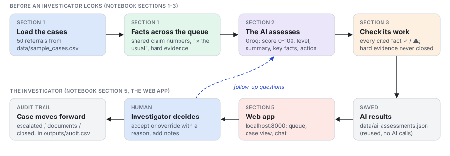
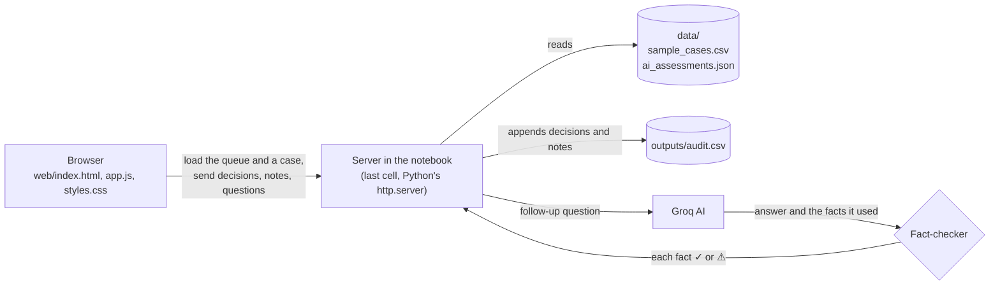
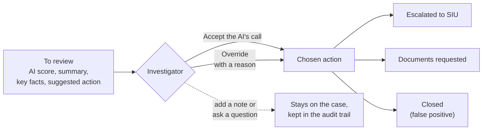

# Case Review: a Junior AI Investigator

Every case in the queue is already a fraud referral; most turn out to be false
alarms. The investigator's real problem is deciding which referrals deserve
their time. This notebook gives each case an AI risk score, a plain-English
explanation and a recommended next step, then serves a web page where the
investigator reviews the queue, asks questions and accepts or overrides every
call.

The logic is in one notebook, [fraud_triage.ipynb](fraud_triage.ipynb); the
page it serves is in [web/](web).



The notebook's sections, in order:

1. **The cases, and what no single row shows.** Loads the 50 cases and adds
   cross-case facts: other cases with the same claim number, and how the
   amount, visits and distance compare with the usual for that type of care.
2. **The AI** (Groq's free tier, gpt-oss-120b, falling back to gpt-oss-20b).
   For each case it returns a 0-100 risk score, a risk level, a short summary,
   the facts behind it, a recommended action and next steps, using only the
   facts it's given.
3. **Checking the AI's work.** Every fact the AI cites is checked against the
   data (✓ or ⚠). Hard evidence (double billing, overlapping visits, a shared
   claim number) can never be closed: the AI is told so, and any case it would
   close or rate Low anyway is flagged.
4. **Plain-English labels** for everything the investigator sees.
5. **The app**, a web page the last cell serves (Python's built-in web
   server, nothing to install): summary cards, filters (risk level, "needs a
   closer look", hide reviewed), the queue highest AI risk first, and a
   sidebar for the open case. There the investigator sees the AI's score and
   reasons, accepts or overrides its call with a reason, leaves notes, sees
   the decision history and asks follow-up questions (answered only from that
   case's facts, and checked the same way). A decision moves the case to its
   next stage (escalated to SIU, documents requested or closed), and the next
   case to review opens. Clean Low cases can be closed in one click. Decisions
   and notes go to `outputs/audit.csv`, an append-only audit trail.

AI results are saved to `data/ai_assessments.json`, so the notebook opens
instantly and reviewers can browse every case without a key (only questions
need one). Delete the file to assess again (about 3 minutes).

## How the app fits together

The page in `web/` talks to a small server started by the notebook's last
cell. The server reads the cases and saved AI results, appends every decision
and note to the audit trail, and sends follow-up questions to the AI, whose
answers are fact-checked before the page shows them.



## How a case moves forward

Every case starts "to review" with the AI's assessment. The investigator
accepts the AI's call or overrides it with a risk level, an action and a
reason; either way the case moves to the stage that action leads to. Notes and
questions can be added at any point, and everything is kept in the audit trail.



Cases with hard evidence (double billing, overlapping visits, a shared claim
number) are never closed by the AI's call, and clean Low cases can be closed
together in one click.

## Run it in Google Colab

1. Open `fraud_triage.ipynb` in Colab (File → Upload notebook).
2. Add your Groq key under Secrets (🔑 in the left sidebar) as `GROQ_API_KEY`.
3. Runtime → Run all. When asked, upload `data/sample_cases.csv`,
   `data/ai_assessments.json`, `web/index.html`, `web/app.js` and
   `web/styles.css` (all five at once).
4. Click the link under the last cell to open the app in a new tab. If your
   browser blocks it, use the same page shown below the link. The default CPU
   runtime is all it needs: the AI runs on Groq's servers.

Colab forgets uploaded files and the audit trail when the session ends.

## Run it locally

```bash
python3 -m venv .venv
source .venv/bin/activate
pip install -r requirements.txt
cp .env.example .env               # then add your GROQ_API_KEY
jupyter notebook fraud_triage.ipynb  # Run all, then open http://localhost:8000
```

Or, without Jupyter, run the notebook's code straight from the terminal and
open http://localhost:8000 (Ctrl+C to stop):

```bash
python run_app.py
```

Get a free Groq key at https://console.groq.com/keys. You can list several
keys, comma-separated (`GROQ_API_KEY=key1,key2`), for more free quota.

See [ASSUMPTIONS.md](ASSUMPTIONS.md) for the assumptions behind the design.
